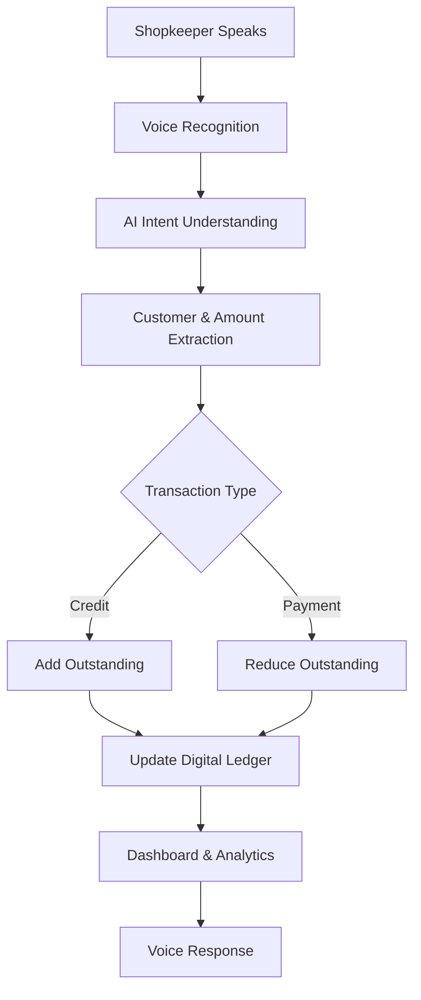

# 🎙️ VOICEFILO 1.0

### Your Voice. Your Business. Your Digital Khata.

\

&#x20; \<b>Speak it. Record it. Track it.\</b>
\

\

&#x20; An AI-powered, voice-first digital ledger built to simplify credit management for India's kirana stores and small businesses.
\

---

## 🌐 Live Demo

🔗 **Live Website:** [https://voice-filo.vercel.app](https://voice-filo.vercel.app)

---

## 📌 About VOICEFILO

VOICEFILO is an AI-powered voice-first digital khata designed for Indian kirana shopkeepers and small businesses.

Traditional bookkeeping often relies on handwritten notebooks, manual calculations, and remembering customer credit transactions. VOICEFILO transforms this process into a natural voice-based experience where shopkeepers can record transactions, track customer dues, and access financial information simply by speaking.

Whether it's recording credit, receiving payments, checking outstanding balances, or reviewing daily business activity, VOICEFILO makes digital bookkeeping more accessible, intuitive, and efficient.

**No complicated forms. No unnecessary typing. Just speak and manage your khata.**

---

## 🚨 The Problem

Thousands of local shopkeepers still manage customer credit using traditional handwritten khata books.

This creates several challenges:

- Difficult tracking of customer outstanding balances
- Manual calculation errors
- Forgotten credit or payment entries
- Time-consuming transaction management
- Limited financial insights
- Digital applications that can be difficult for non-technical users

---

## 💡 Our Solution

VOICEFILO introduces a conversational approach to bookkeeping.

Shopkeepers can speak naturally to record transactions, check customer dues, and manage their digital ledger. The system interprets their intent and converts their speech into structured financial records.

Our goal is to make digital bookkeeping feel as simple and familiar as speaking to another person.

---

## ✨ Key Features

### 🎤 Voice-First Khata

Record customer transactions through natural voice commands.

### 🧠 AI-Powered Understanding

Interpret conversational commands and understand transaction intent.

### 🇮🇳 Hindi & Hinglish Friendly

Designed around the way Indian shopkeepers naturally communicate.

### 📒 Digital Customer Ledger

Maintain customer-wise credit, payment, and outstanding records.

### 💰 Smart Balance Tracking

Track customer balances through structured transaction records.

### 🔄 Transaction Correction

Correct transaction details when speech recognition misunderstands an amount.

### 👥 Customer Management

Manage customer information and their transaction histories.

### 📊 Business Dashboard

Get an overview of daily activity, outstanding dues, credits, and payments.

### 🔊 Voice-Based Queries

Ask questions about customers and business transactions using natural speech.

---

## 🗣️ Voice Command Examples

| Command                      | Function                             |
| ---------------------------- | ------------------------------------ |
| `Ramesh ka 340 udhaar`       | Record ₹340 as customer credit       |
| `Ramesh ne 200 diye`         | Record ₹200 payment                  |
| `Ramesh ka kitna baaki hai?` | Check customer's outstanding balance |
| `Aaj kitna udhaar gaya?`     | Review today's credit                |
| `Nahi, 430`                  | Correct a previously spoken amount   |
| `Kal ka hisaab dikhao`       | View previous day's transactions     |

---

## ⚙️ How VOICEFILO Works

### Workflow

1. **Speak** – Shopkeeper gives a natural voice command.
2. **Recognize** – Speech is converted into text.
3. **Understand** – AI extracts the customer, amount, and transaction intent.
4. **Validate** – The transaction is interpreted and checked.
5. **Record** – The digital ledger is updated.
6. **Respond** – VOICEFILO confirms the transaction or answers the query.

---

## 📊 Dashboard & Insights

VOICEFILO brings essential business information together in one interface.

- Total outstanding credit
- Credit given today
- Payments received today
- Total customers
- Customers with outstanding balances
- Recent transaction history
- Customer-wise dues
- Business activity overview
- Credit and payment trends

---

## 🆚 Traditional Khata vs VOICEFILO

| Traditional Khata                   | VOICEFILO                  |
| ----------------------------------- | -------------------------- |
| Handwritten transactions            | Voice-based transactions   |
| Manual calculations                 | Automated balance tracking |
| Time-consuming entries              | Conversational interaction |
| Difficult to analyze daily activity | Dashboard insights         |
| Manual customer tracking            | Digital customer ledger    |
| Paper-based records                 | Structured digital records |

---

## 🎯 Target Users

- Kirana store owners
- Local shopkeepers
- Small retail businesses
- Street vendors
- Independent merchants
- Small businesses managing customer credit

---

## 🛠️ Technology Stack

> Modify this list according to the technologies actually used in the final implementation.

- **Frontend:** React.js
- **Build Tool:** Vite
- **Programming:** JavaScript / TypeScript
- **Styling:** Tailwind CSS
- **Animations:** Framer Motion
- **Icons:** Lucide
- **AI:** AI-powered intent interpretation
- **Voice:** Speech Recognition & Speech Synthesis
- **Deployment:** Vercel

---

## 🔮 Future Scope

- Enhanced multilingual speech recognition
- Regional Indian language support
- Offline-first transaction recording
- Secure cloud synchronization
- WhatsApp-based payment reminders
- PDF ledger exports
- Customer payment history reports
- Multi-store management
- AI-powered financial insights
- Smart business analytics
- Automated backup and recovery

---

## 🔐 Privacy & Responsible AI

VOICEFILO aims to make financial technology accessible while prioritizing responsible data handling.

- Secure handling of financial records
- Protected API credentials
- Privacy-conscious voice processing
- Transparent AI interactions
- Consent-based reminders
- Synthetic data for demonstration purposes
---

## 🏆 Project

**VOICEFILO 1.0 — AI Voice Khata**

Built around the idea of making digital bookkeeping natural, accessible, and voice-first for India's local businesses.

🌐 **Experience VOICEFILO:** [https://voice-filo.vercel.app](https://voice-filo.vercel.app)

---

\

&#x20; \<b>🎙️ VOICEFILO\</b>\ 
&#x20; \<i>Your Voice. Your Business. Your Digital Khata.\</i>
\

